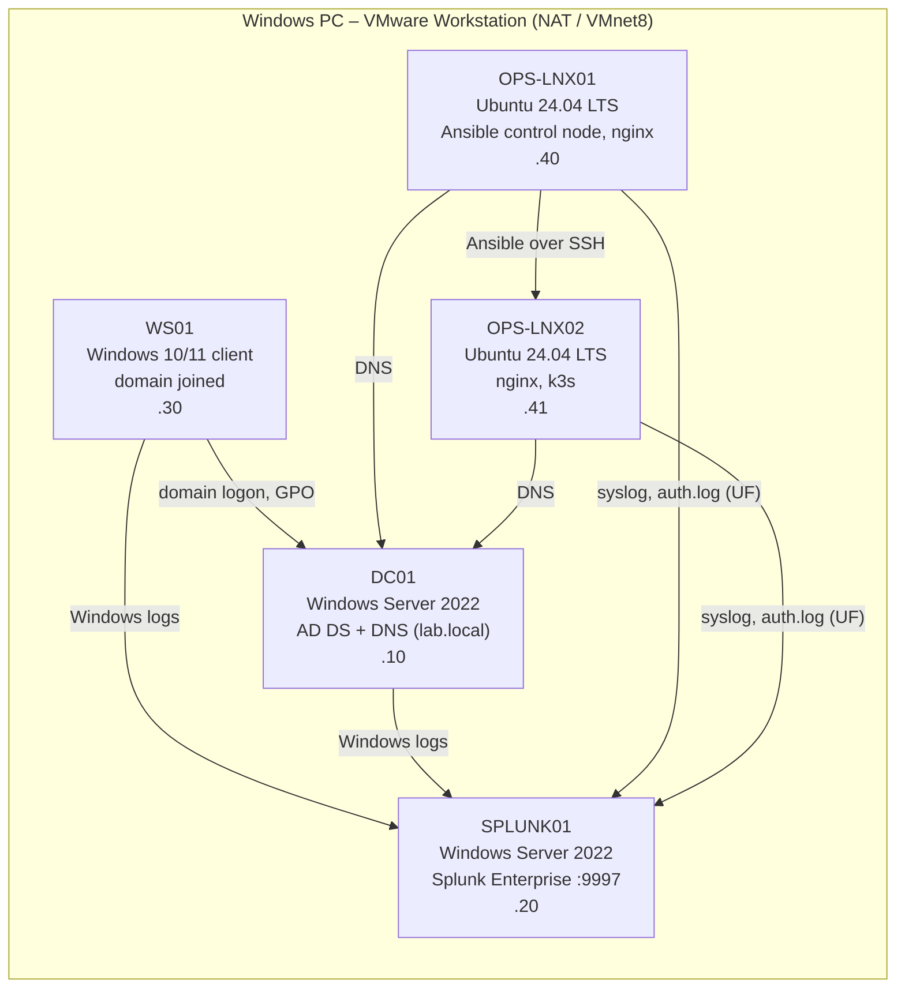

# Operations Technician Simulation

A hands-on lab where I practise the daily work of an Operations Center technician:
handling events, incidents and changes on Windows and Linux servers, troubleshooting,
scripting, automation with Ansible, log monitoring with Splunk and a first look at Kubernetes.

Every exercise follows the same loop that a real 24/7 operations shift uses:

1. **Event** – something breaks (a fault-injection script simulates it).
2. **Detect** – I notice it (check script, Splunk search, health check).
3. **Diagnose and fix** – I troubleshoot with standard tools and write down every command.
4. **Restore** – a restore script puts the lab back to a known good state.
5. **Document** – I write a runbook, an incident report or change request (ITIL style) and a lab journal entry.

> **Status:** the structure, scripts and templates are in place.
> Results, findings and lessons learned are written by me after I run each exercise.
> Anything marked `TODO` has not been done yet.

## Lab topology

All machines run in VMware Workstation on one Windows PC, on the NAT network (VMnet8).

> **TODO:** the IP addresses below use `192.168.100.x` as a placeholder.
> Replace `192.168.100` with the real VMnet8 subnet before running anything
> (see [docs/lab-setup.md](docs/lab-setup.md#0-find-your-subnet)).



| Host | OS | Role | IP |
|------|----|------|----|
| DC01 | Windows Server 2022 | Domain controller and DNS for `lab.local` | .10 |
| SPLUNK01 | Windows Server 2022 | Splunk Enterprise, receives on TCP 9997, indexes `wineventlog`, `sysmon`, `linux` | .20 |
| WS01 | Windows 10/11 | Domain-joined client, GPO testing | .30 |
| OPS-LNX01 | Ubuntu Server 24.04 LTS | Ansible control node, nginx, Linux scenarios | .40 |
| OPS-LNX02 | Ubuntu Server 24.04 LTS | Managed node, nginx, k3s (Kubernetes) | .41 |

## Repository layout

| Folder | What is in it |
|--------|---------------|
| [docs/](docs/) | Lab setup guide, lab journal template, skills matrix |
| [itil/](itil/) | Incident and change templates, plus empty examples to fill in |
| [linux/](linux/) | Cheat sheet and eight break/fix scenarios |
| [windows/](windows/) | Health check, AD onboarding/offboarding, four scenarios |
| [ansible/](ansible/) | Inventory, config and five playbooks |
| [monitoring/](monitoring/) | Splunk Universal Forwarder config and saved searches |
| [kubernetes/](kubernetes/) | k3s install, nginx deployment, one troubleshooting scenario |
| [scripts/](scripts/) | Linux health check that logs to syslog (picked up by Splunk) |

## How to use this repo

1. Build the lab: follow [docs/lab-setup.md](docs/lab-setup.md).
2. Clone the repo on OPS-LNX01 (and copy the `windows/` folder to the Windows machines).
3. Pick an exercise in the order in [docs/skills-matrix.md](docs/skills-matrix.md#suggested-order-two-days).
4. For a break/fix scenario:
   ```bash
   cd linux/scenarios/01-service-down
   sudo ./check.sh      # see the healthy state first
   sudo ./break.sh      # inject the fault (asks for confirmation)
   # ... troubleshoot as if it were a real ticket, write down every command ...
   sudo ./check.sh      # confirm your fix worked
   sudo ./restore.sh    # always return to a known good state
   ```
5. Fill in the scenario's `runbook.md`, an incident report from [itil/](itil/) and an entry in [docs/lab-journal.md](docs/lab-journal.md).

### Safety rules built into every fault-injection script

- It refuses to run unless the hostname is one of the lab machines (`OPS-LNX01`, `OPS-LNX02`, `DC01`, `WS01`).
- It asks for confirmation before changing anything.
- It has a matching `restore` script that returns the machine to a known good state.

### Linting

Everything is linted locally and in GitHub Actions ([.github/workflows/lint.yml](.github/workflows/lint.yml)):

```bash
shellcheck -x $(git ls-files '*.sh')
yamllint .
cd ansible && ansible-lint
```

PowerShell is checked with PSScriptAnalyzer (runs in the Windows CI job, or locally on a Windows machine):

```powershell
Install-Module PSScriptAnalyzer -Scope CurrentUser
Invoke-ScriptAnalyzer -Path .\windows -Recurse
```

## Skills shown

| Exercise | What I do | Job requirement it maps to |
|----------|-----------|----------------------------|
| Linux scenario 01 – service down | Find and restart a stopped/disabled nginx with `systemctl` and `journalctl` | Incident handling, troubleshooting, Linux servers |
| Linux scenario 02 – disk full | Find what filled `/var` with `df`/`du`, free space safely | Event handling, troubleshooting, Linux servers |
| Linux scenario 03 – config error | Read `nginx -t` output, fix a bad config, restart | Troubleshooting, implementing changes |
| Linux scenario 04 – permissions | Fix wrong owner/mode on the web root (`chown`, `chmod`) | Troubleshooting, Linux servers |
| Linux scenario 05 – cron failing | Trace a failing scheduled job through syslog | Event handling, scripting, Linux servers |
| Linux scenario 06 – SSH access | Restore a user's SSH key login, read `auth.log` | Incident handling, customer contact (user locked out) |
| Linux scenario 07 – high load | Find and stop a runaway process with `top`/`ps` | Event handling, troubleshooting |
| Linux scenario 08 – DNS resolution | Fix a wrong resolver config with `dig`/`resolvectl` | Troubleshooting, networking |
| Windows health check | PowerShell report: services, disks, event log errors, uptime, pending reboot | Windows servers, scripting and automation |
| AD onboarding/offboarding | Create/disable users from CSV, groups, OUs, logging | Windows servers, implementing changes, automation |
| Windows scenarios 01–03 | Stopped service, full disk, missing DNS record on DC01 | Incident handling, Windows servers |
| Windows scenario 04 – GPO change | Plan, test and roll back a GPO change on WS01 | Change management, implementing changes |
| Ansible playbooks | Ping, patching with controlled reboot, nginx with handlers, users, health report | Ansible, implementing upgrades, automation |
| Splunk forwarding and searches | Forward Linux logs, build searches and an alert | Event handling, monitoring |
| Kubernetes (k3s) | Deploy, scale, inspect nginx; fix a pod that will not start | Kubernetes, troubleshooting |
| ITIL documents | Incident reports and change requests for the exercises | Incidents and changes, customer contact |

## Author

Ulas Korhan – Network and IT Security (Noroff, 2026).
